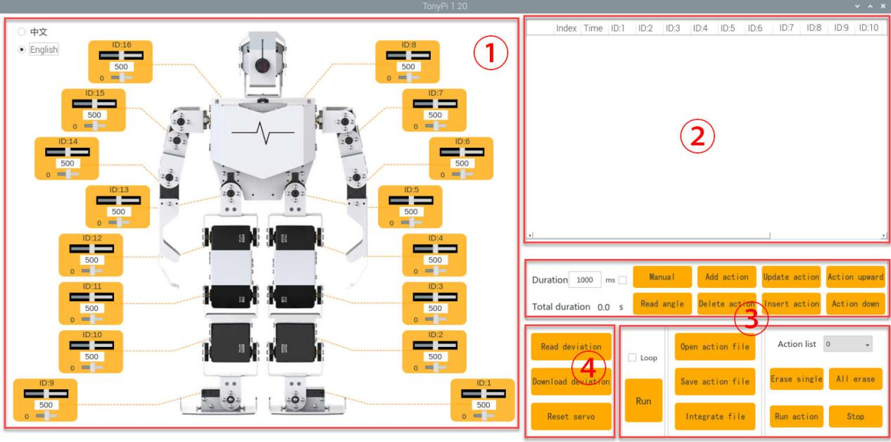

# TonyPi Servo Joint Map

Which servo ID drives which joint, how that was verified, and what is *not* known yet.

## Body (bus servos 1–16)

Robot's left = IDs 1–8, right = IDs 9–16, same order, foot to shoulder.

| Joint | Left | Right |
|---|---|---|
| Ankle roll | 1 | 9 |
| Ankle pitch | 2 | 10 |
| Knee | 3 | 11 |
| Hip pitch | 4 | 12 |
| Hip roll | 5 | 13 |
| Elbow | 6 | 14 |
| Shoulder roll | 7 | 15 |
| Shoulder pitch | 8 | 16 |

The digital twin models elbows 6/14 as mirrored inward-sweeping hinges (local +X/-X
with x forward, y left, z up), based on observed hardware motion. They cannot curl
forward independently of the shoulder. The API returns raw servo positions; it does
not report joint axes. The stand pulses 575/425 are the straight-arm reference.

Bus servo position range is 0–1000 (500 = middle); deviation (offset) range is -125 to 125.

## Head (PWM servos)

| PWM ID | Joint |
|---|---|
| 1 | Head tilt (up/down) |
| 2 | Head pan (left/right) |

PWM neutral is 1500. The default head pose is in `/home/pi/TonyPi/servo_config.yaml`
(`servo1`, `servo2`) on the robot.

## Hands (bus servos 17, 18)

| Servo | Open | Closed (rest) |
|---|---|---|
| 17 | 760 | 500 |
| 18 | 240 | 500 |

- Values come from docs ch. 8.3 (`right_splay` / `right_grasp`) and the robot's
  `grab_left` / `grab_right` action groups. The hands are mirrored, so 18 opens toward 240.
- **Left/right is unconfirmed.** The PC-software chapter (ch. 4) says 17 = left and 18 = right.
  The gripper example code (ch. 8.3) drives 17 as the right hand.
- The hand servos accept move commands but never answer bus reads (position, temperature,
  limits), so they can't be monitored from software.

## Sources and verification

- **Official servo diagram:** where each ID sits on the robot.
  
  From the [TonyPi Pro docs, ch. 4](https://docs.hiwonder.com/projects/TonyPi_Pro/en/latest/docs/4_pc_software_action_control_courses.html)
  ([original image](https://docs.hiwonder.com/projects/TonyPi_Pro/en/latest/_static/media/chapter_4/section_1/image3.jpeg)).
  The local copy in `docs/site` is missing chapter 4's images.
- **Joint names (roll vs. pitch):** from the community (not Hiwonder) repo
  [pab47/TonyPi](https://github.com/pab47/TonyPi) (`control/servo_map.py`, `model/robot.xml`).
  The order matches the official diagram.
- **Consistent with the docs' example code:**
  - Arm raise moves shoulder pitch (16) before shoulder roll and elbow (15, 14).
  - Body mimicry drives elbows and shoulder rolls (6, 7, 14, 15).
  - The left arm (6–8) carries the ultrasonic sensor; the right arm (14–16) does grasping.

## Limits and safety notes

- **No servo has angle limits set.** All 16 body servos report firmware angle limits of 0–1000.
  The SDK (`hiwonder.Controller`, `ros_robot_controller_sdk`) passes commands through unclamped.
- **The docs give no per-joint safe ranges or collision rules.**
  - The only explicit clamp is 125–875 on servos 6, 7, 14 and 15 in the body-mimic example (ch. 5).
  - The head pan/tilt servos have hardware limit protection, but no values are given.
- **Factory action groups use nearly the full range on many joints** (e.g. servo 8: 0–1000,
  servo 3: 0–960). Fixed per-joint limits alone can't prevent self-collision. Whether a pose is
  safe depends on the other joints (e.g. shoulder roll inward is only safe with the arm forward).
- **Don't trust the pab47 joint ranges or calibration as limits.** Converted to pulses, they
  contradict factory moves (e.g. servo 4: model max 672, factory max 857). Its MuJoCo model does
  have self-collision shapes, which could support pose collision checks once recalibrated.
- **Servo temperature cutoff is 85 °C.** Holding the standing pose for a long time drove leg
  servos (3, 9, 10, 13) to 74–83 °C. Coast mode (`Controller.unload_bus_servo`) cooled them to
  about 40 °C within 5 minutes. With torque off the robot can't support itself, so support it first.
