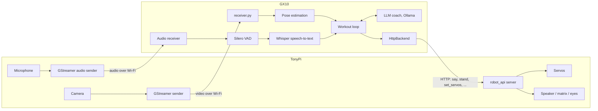
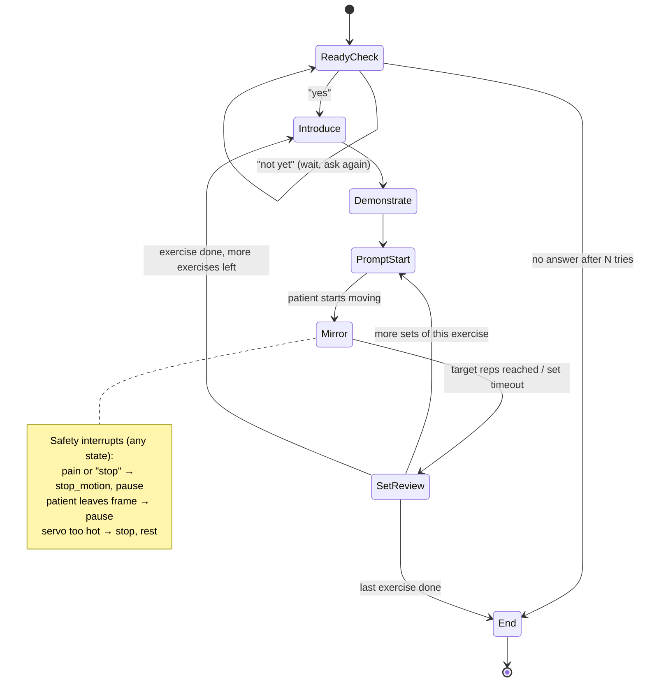

# Workout Agent Loop

How Baymax runs a physical therapy workout with a patient. The robot checks that the patient is ready, then for each exercise it names the exercise, demonstrates it, and mirrors the patient while they do it. After each set it gives form feedback and asks how the set went.

## Where things run

Two machines:
- **TonyPi** (the robot, a Raspberry Pi): the body. It runs the robot API server (`robot_api/server.py`) and the camera sender (`streaming/start_pi_sender.sh`). It moves the servos, speaks through its speaker, and shows things on the dot matrix and eye LEDs.
- **GX10**: the brain. It runs the workout loop itself, the LLM (Ollama), pose estimation on the video stream, and speech-to-text.



Rule of thumb: anything heavy (models, vision, decisions) runs on the GX10. The TonyPi only carries out commands through its HTTP API. So the workout loop is a GX10 program that uses `client.HttpBackend` to talk to the robot.

## Overview



Pseudocode:

```text
session = load_workout_plan(patient)
if not ready_check(): end_session("not started")

for exercise in session.exercises:
    introduce(exercise)
    demonstrate(exercise)
    for set_number in 1..exercise.sets:
        prompt_start(exercise, set_number)
        result = mirror_and_track(exercise)        # rep count + per-rep form deviations
        give_form_feedback(result)                 # skipped when form was good
        answer = ask("Did you have any trouble with that set?")
        log_set(exercise, set_number, result, answer)
        if answer signals pain: pause_and_escalate(); break

end_session("completed")
```

## States

### 1. Ready check

| | |
|---|---|
| Robot says | "Hi! Are you ready to start your workout?" |
| Robot does | Stands (`stand`), faces the patient (head track), eyes a calm color (`set_eye_color`). |
| Listens for | Yes / no, through [voice input](#voice-input). The LLM classifies the answer as `ready`, `not_ready` or `unclear`. |
| Next | **Yes** → Introduce. **No / not yet** → "No problem, tell me when you're ready," wait about 30 s, ask again. Stop after N tries. |

### 2. Introduce the exercise

| | |
|---|---|
| Robot says | The exercise name and one short cue, for example "Our first exercise is arm raises. Lift both arms to shoulder height, then lower them slowly." |
| Robot does | Shows the exercise name on the dot matrix (`show_on_matrix`). |
| Next | Demonstrate. |

### 3. Demonstrate

| | |
|---|---|
| Robot says | Narrates while moving: "Up… and down." |
| Robot does | Plays the exercise's motion once or twice, either a factory action group (`run_action_group`, for example `squat`, `wings_up`) or a keyframe sequence of `set_servos` calls written for the exercise. |
| Next | Prompt start. |

Each exercise in the plan needs a demonstration motion that the robot can do safely. Leg exercises are the hard part: bending leg joints one at a time while standing makes the robot fall, so leg demonstrations should use tested action groups only.

### 4. Prompt the patient to start

| | |
|---|---|
| Robot says | "Your turn! Let's do 10 reps. Start when you're ready." (On later sets: "Set 2 of 3.") |
| Robot does | Optional 3-2-1 countdown with `beep`. Checks that pose tracking sees the patient's whole body. If not: "Can you step back so I can see you?" |
| Next | Mirror, once the patient's pose starts moving. |

### 5. Mirror and track

The main loop for the set. It runs on the GX10 using frames from `streaming/receiver.py`, and sends servo targets back to the TonyPi through the robot API.

Each frame:
1. Run pose estimation (MediaPipe pose landmarker) on the newest frame.
2. **Mirror:** map the patient's joint angles to the robot's servos, like `scripts/face_track.py --mode human` does for the arms. The robot moves along with the patient, which gives live feedback without words.
3. **Count reps:** track the main joint angle for the exercise (for example shoulder elevation for arm raises) and count a rep on each full cycle.
4. **Check form:** compare the patient's angles to the exercise's targets and record any deviation for this rep, such as "left elbow bent 30° at the top" or "hips shifted right."

Ends when the target reps are reached, or after a timeout if the patient stops moving.

Rules for mirroring:
- Rate-limit and smooth servo commands. The API already enforces at least 300 ms per move and one move at a time, so the robot moves more slowly than the patient. That's fine; it only needs to follow the movement roughly.
- Mirror only joints that are safe to move by themselves (arms, head). For leg exercises, the robot should stay standing and use the eyes or matrix to show progress (for example a rep counter) instead of copying the legs.
- Don't stop the set for small form problems. Save them for the review, unless something looks unsafe.

### 6. Set review

| | |
|---|---|
| Robot does | Ends mirroring and returns to `stand`. |
| Form feedback | If the set had deviations, turn them into one or two short, encouraging sentences with the LLM coach on the GX10 (the pattern in `coach_test.py`). Example: "Nice work! Try to keep your elbows straight at the top." If form was good, just praise: "Great form on that set!" |
| Robot asks | "Did you have any trouble with that set?" |
| Listens for | A free-form answer, through [voice input](#voice-input). The LLM classifies it as `none`, `difficulty` (too hard or too easy) or `pain`, plus a short note. |
| Next | Pain → safety pause (below). Otherwise: more sets → Prompt start. Last set → next exercise's Introduce, or End. |

Save each set's rep count, form deviations, and the patient's answer in the session log, so a therapist can review them later.

### 7. End of session

The robot says "That's the whole workout, great job!", gives a one-sentence summary (for example "You finished all 3 exercises; your arm raises got smoother each set"), returns to `stand`, and saves the session log.

## Voice input

The patient answers out loud. The robot's microphone records the audio, and the GX10 turns it into text and decides what it means.

```text
TonyPi USB mic ──GStreamer (Opus/RTP/UDP)──▶ GX10 ──▶ Silero VAD ──▶ Whisper ──▶ transcript
                                                                                  │
                                         pain keyword check (every transcript) ◀──┤
                                         LLM classifier (when a question is asked) ◀──┘
```

### Microphone: the robot's own

The TonyPi already has a USB audio card with a microphone (`plughw:CARD=Device`, the one `robot_api/sensors/microphone.py` records from). The robot faces the patient for the whole workout, so its mic is in the right place.

The audio goes to the GX10 the same way the video does (built in #8): `streaming/start_pi_sender.sh` starts a second GStreamer pipeline that sends the mic as Opus over RTP on port 5002 (`AUDIO_PORT` in `streaming/config.env`). It records from `mic_shared`, a shared device made by `streaming/setup_pi_audio.sh`, so the robot API's `mic_level` can use the mic at the same time.

On the GX10, `streaming/audio_receiver.py` (`AudioReceiver`) decodes it back to 16 kHz mono and keeps the last 30 s, with each chunk stamped with its GX10 arrival time. Opus at 24 kbps barely affects the video. See [running-the-stream.md](running-the-stream.md).

The WonderEcho voice box isn't used for this. It only recognizes a fixed list of command words, and only after its wake phrase ("hello hiwonder").

### Detecting speech: Silero VAD

Silero VAD runs on the GX10 over the incoming audio. It marks when the patient starts and stops talking, so only speech gets transcribed. It also decides when an answer is finished: about 0.8 s of silence after speech ends it.

### Speech-to-text: Whisper

Use a small English-only Whisper model (`small.en`, or `base.en` if you need it faster). Answers are short, so transcription takes well under a second.
- Start with **faster-whisper** on the GX10's CPU.
- To use the GPU, use **whisper.cpp** built with CUDA. The GX10 is an ARM machine, and faster-whisper's GPU backend may not install cleanly there, so check before relying on it.

### Not hearing itself

The speaker and the mic are on the same USB audio card, so the mic picks up Baymax's own voice. `say` blocks until the robot finishes talking, so the loop ignores audio while `say` runs and for about 300 ms afterward. This is simpler than echo cancellation and works because the conversation takes turns.

### Understanding answers

There are two checks on each transcript:

1. **Pain keyword check, on every transcript, at any time (including mid-set).** A plain word list ("stop," "ow," "hurts," ...) that triggers the [safety interrupt](#safety-interrupts) right away, without waiting for the LLM.
2. **LLM classifier, only when the robot asked a question.** The transcript goes to Ollama with a JSON schema, the same way as `coach_test.py`:

   | Question | Schema |
   |---|---|
   | "Are you ready?" | `{"answer": "ready" \| "not_ready" \| "unclear"}` |
   | "Did you have any trouble?" | `{"answer": "none" \| "difficulty" \| "pain", "note": string}` |

   `unclear` makes the robot ask again ("Sorry, I didn't catch that. Are you ready?"). If the LLM says `pain` even though no keyword matched, it's treated the same as a pain keyword.

### `listen()` on the GX10

The loop uses one function:

```python
listen(timeout_s=10) -> str | None   # waits for the next finished utterance; None if nobody spoke
```

It drops audio captured while `say` was running, runs VAD and Whisper, applies the pain keyword check, and returns the transcript.

## Safety interrupts

These can happen in any state and always win over the normal flow:

| Trigger | Response |
|---|---|
| Patient says "stop," "ow," "that hurts," or reports pain | `stop_motion`, "Let's stop here." Don't continue the exercise. Flag the session for the therapist. |
| Patient leaves the camera view mid-set | Pause mirroring, "I can't see you, are you OK?" Resume when the patient is back. |
| Servo too hot (API refuses motion) | Stop demonstrating and mirroring, explain that the robot needs a short rest, and continue with voice-only coaching or end the session. |
| No response for a long time | Ask once more, then end the session safely. |

The robot coaches but doesn't diagnose. All feedback stays about form and effort ("keep your back straight"), never medical ("you may have a torn rotator cuff").

## What each step uses

| Need | Runs on | Existing piece | Gap |
|---|---|---|---|
| Run the loop / decide what's next | GX10 | `client.HttpBackend` for robot calls | The workout loop program itself |
| Speak | TonyPi | `say` (espeak-ng), called over HTTP from the GX10 | — |
| Hear the patient | TonyPi mic → GX10 | Audio stream (`streaming/audio_receiver.py`) | VAD and Whisper `listen()`; see [Voice input](#voice-input) |
| Understand answers | GX10 | Ollama with a JSON schema (`coach_test.py`) | The two classifier prompts and the pain keyword list |
| Demonstrate | TonyPi | `run_action_group`, `set_servos` | Demonstration motions for each exercise in the plan |
| See the patient | TonyPi camera → GX10 | GX10 stream (`streaming/receiver.py`) | — |
| Pose estimation | GX10 | MediaPipe (used in `scripts/face_track.py`) | Run it on the GX10 over the stream |
| Mirror arms | GX10 computes, TonyPi moves | `scripts/face_track.py --mode human` (runs fully on the Pi) | Move the angle mapping to the GX10 and send servo targets through the robot API |
| Count reps / check form | GX10 | — | Per-exercise target angles and a rep counter |
| Turn deviations into feedback | GX10 | `coach_test.py` (Ollama) | Wire into the loop |
| Workout plan | GX10 | — | Format for exercises, reps, sets, target angles, demo motion |

Latency: every robot action is an HTTP call over the Pi's Wi-Fi, and the API needs at least 300 ms per move. Mirroring should send at most a few servo updates per second and skip stale frames (`rx.latest()` already returns only the newest one).

## Example workout plan

```yaml
exercises:
  - name: Arm raises
    cue: Lift both arms to shoulder height, then lower them slowly.
    demo: { action_group: wings_up, times: 2 }
    sets: 3
    reps: 10
    mirror: arms
    track_joint: shoulder_elevation
    targets:
      shoulder_elevation: { top: 90, bottom: 10, tolerance: 15 }   # degrees
      elbow: { min: 160 }                                          # keep arms straight
  - name: Mini squats
    cue: Bend your knees a little, keeping your back straight, then stand up.
    demo: { action_group: squat, times: 2 }
    sets: 2
    reps: 8
    mirror: none          # robot doesn't copy leg moves; shows the rep count on the matrix
    track_joint: knee
    targets:
      knee: { bottom: 120, tolerance: 15 }
      trunk_lean: { max: 20 }
```

## Open questions

- **Pain keywords:** which words stop the session right away. Too few and real pain gets missed; too many and Baymax stops for "this is hard."
- **Pain policy:** after a pain report, should the session end, skip to the next exercise, or offer an easier version? The doc assumes it stops and flags the session for the therapist.
- **Not-ready policy:** how many times to re-ask, and how long to wait between asks.
- **Feedback during a set:** only at the end of the set (current design), or also a short live cue when the same mistake repeats several times?
